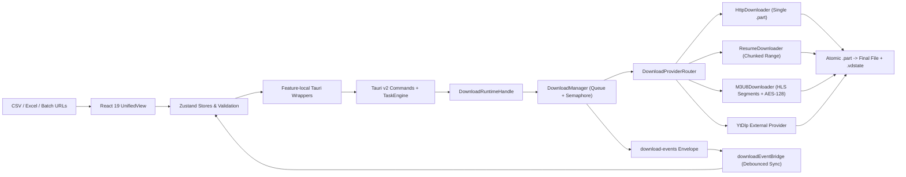

<div align="center">

# Video Downloader Pro

**English** | [简体中文](README.zh-CN.md)

**High-reliability, cross-platform batch desktop video downloader built with
Rust, Tauri v2, React 19, and TypeScript.**

[](https://github.com/seaworld008/tauri-video-batch-downloader/actions/workflows/ci.yml)
[](https://github.com/seaworld008/tauri-video-batch-downloader/actions/workflows/security.yml)
[](https://github.com/seaworld008/tauri-video-batch-downloader/actions/workflows/release.yml)
[](LICENSE)


</div>

---

**Video Downloader Pro** turns messy spreadsheet course lists, batch URLs,
direct HTTP streams, HLS (`.m3u8`), and supported public video pages into an
observable, pause/resume-safe desktop download queue powered by a Rust core.

## Table of Contents

- [Why Video Downloader Pro](#why-video-downloader-pro)
- [Core Capabilities](#core-capabilities)
- [Architecture](#architecture)
- [Quick Start](#quick-start)
- [Quality Gates & Testing](#quality-gates--testing)
- [Documentation Hub](#documentation-hub)
- [Roadmap](#roadmap)
- [Contributing & Security](#contributing--security)
- [License](#license)

---

## Why Video Downloader Pro

- **Rust Download Core**: Queue priority scheduling, Tokio semaphore
  concurrency, HTTP Range/resumption, rate limiting, and atomic `.part` file
  commits run natively in Rust.
- **Real Batch Import**: Import large CSV / Excel spreadsheets with encoding
  detection, interactive header mapping, row previews, and duplicate task
  reconciliation (`completed`, `resumable`, `pending`, `failed`).
- **Explainable Crash & Restart Recovery**: Persisted sessions restore tasks and
  local `.part`/`.vdstate` markers cleanly without silently auto-starting
  background network transfers.
- **Per-Task Protocol Isolation**: Isolated task cancellation, pause state
  preservation, segment reuse on HLS `.m3u8` resume, monotonic token-bucket
  throttling, and per-row support diagnostic bundles.
- **Event-Driven React 19 UI**: Typed Tauri v2 `download-events` envelope feeds
  a Zustand store and virtualized task list without blocking UI threads.

---

## Core Capabilities

| Area                        | Current Capabilities (`v1.1.0`)                                                                                                                                                 |
| --------------------------- | ------------------------------------------------------------------------------------------------------------------------------------------------------------------------------- |
| **Batch Input**             | Excel (`.xlsx`/`.xls`), CSV encoding auto-detection, field mapping, clipboard batch paste, single/multi-URL validation                                                          |
| **Queue & Controls**        | Global Start/Pause/Retry/Clear, per-row Start/Pause/Resume/Retry/Delete, batch selection & output directory override                                                            |
| **Protocols & Providers**   | Native HTTP/HTTPS (single-stream `.part` + multi-range chunked `ResumeDownloader`), native HLS (`.m3u8` AES-128 & byte-range), unified `yt-dlp` provider for public video sites |
| **Reliability & Integrity** | Atomic `.part` commit (`sync_all` + rename), atomic config writes, `RetryExecutor` with circuit breaker, `spawn_blocking` SHA-256/MD5 verification                              |
| **Observability**           | Live per-task speed & ETA, queue overview status badge, `average_commit_duration` / `p95_commit_duration`, one-click task diagnostic copy                                       |
| **Cross-Platform**          | Tauri v2 desktop builds for Windows (`nsis`), macOS (`universal` `.dmg`), and Linux                                                                                             |

---

## Architecture



---

## Quick Start

### Prerequisites

| Tool             | Minimum Version      | Notes                                                                                          |
| ---------------- | -------------------- | ---------------------------------------------------------------------------------------------- |
| **Node.js**      | `>= 20.x`            | Declared in `package.json#engines`                                                             |
| **pnpm**         | `>= 9.15.0`          | Enable via `corepack enable`                                                                   |
| **Rust**         | `stable` (`>= 1.78`) | Verified on `rustc 1.89.0`                                                                     |
| **Platform SDK** | OS-specific          | **Windows**: WebView2 + MSVC; **macOS**: Xcode CLI Tools; **Linux**: `webkit2gtk` & `libgtk-3` |

### Install & Run (Development)

```bash
corepack enable
corepack prepare pnpm@9.15.0 --activate
pnpm install --frozen-lockfile

# Launch full desktop Tauri app in development mode
pnpm dev
```

### Build Production Bundles

Production builds require real external sidecars (`yt-dlp`, `ffmpeg`, `deno`)
inside `src-tauri/binaries/` matching your target triple:

```bash
# 1. Fetch/prepare platform sidecars and verify strict release policy
pnpm sidecars:prepare
pnpm sidecars:check

# 2. Build production installer / app bundle
pnpm build
```

For local desktop smoke builds without production sidecars:

```bash
pnpm build:local
```

---

## Quality Gates & Testing

```bash
# Frontend static checks & tests
pnpm type-check
pnpm lint
pnpm exec vitest run
pnpm exec vitest run --config vitest.config.integration.ts
pnpm exec vite build

# Backend Rust checks & tests
cargo fmt --manifest-path src-tauri/Cargo.toml --all --check
cargo clippy --manifest-path src-tauri/Cargo.toml --all-targets -- -D warnings
cargo test --manifest-path src-tauri/Cargo.toml

# Sidecar & dependency audits
pnpm sidecars:check:local
pnpm audit --prod --audit-level moderate
```

---

## Documentation Hub

| Topic                        | Document                                                                         |
| ---------------------------- | -------------------------------------------------------------------------------- |
| Full Architecture & Design   | [docs/architecture-functional-design.md](docs/architecture-functional-design.md) |
| Live System State (`v1.1.0`) | [docs/current-state.md](docs/current-state.md)                                   |
| Documentation Index          | [docs/index.md](docs/index.md)                                                   |
| Build & Release Guide        | [docs/build-release.md](docs/build-release.md)                                   |
| Contributing Guide           | [CONTRIBUTING.md](CONTRIBUTING.md)                                               |
| Changelog                    | [CHANGELOG.md](CHANGELOG.md)                                                     |
| Security Policy              | [SECURITY.md](SECURITY.md)                                                       |
| AI Agent Protocol            | [AGENTS.md](AGENTS.md)                                                           |

---

## Roadmap

- **`v1.1.0` (Current)**: Core reliability hardening, per-task M3U8 isolation,
  atomic `.part` / config writes, UI settings wiring, per-row controls, and OSS
  foundation.
- **`v1.2.0` (Next)**: Pluggable `DownloadProvider` trait registry, native HLS
  Master Playlist (variant/audio/subtitle track selection + fMP4 + FFmpeg
  remux), native MPEG-DASH (`.mpd`) downloader, and per-task custom headers /
  cookies / proxy parity with `yt-dlp`.
- **`v1.3.0`**: Full frontend & tray i18n (`zh-CN` / `en-US` parity), keyboard
  shortcuts, desktop notifications & system tray minimize, and headless CLI
  companion.
- **`v2.0.0`**: Modular Cargo Workspace separation (`core`, `providers`,
  `storage`, `tauri-app`), SQLite WAL persistent storage replacing monolithic
  JSON snapshots, and companion browser integration.

See [docs/roadmap.md](docs/roadmap.md) for detailed milestones.

---

## Contributing & Security

- Read [CONTRIBUTING.md](CONTRIBUTING.md) and our
  [Code of Conduct](CODE_OF_CONDUCT.md) before opening a PR.
- Report security issues privately via [SECURITY.md](SECURITY.md) — never open
  public issues for security vulnerabilities.

## License

Released under the [MIT License](LICENSE).
