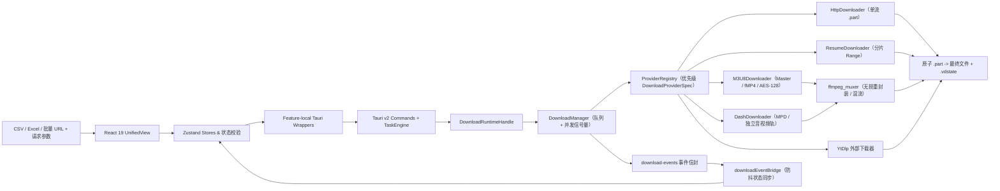

<div align="center">

# Video Downloader Pro

[English](README.md) | **简体中文**

**基于 Rust、Tauri v2、React
19 与 TypeScript 构建的高可靠跨平台批量桌面视频下载器。**

[](https://github.com/seaworld008/tauri-video-batch-downloader/actions/workflows/ci.yml)
[](https://github.com/seaworld008/tauri-video-batch-downloader/actions/workflows/security.yml)
[](https://github.com/seaworld008/tauri-video-batch-downloader/actions/workflows/release.yml)
[](LICENSE)


</div>

---

**Video Downloader Pro** 面向真实批量下载与流媒体采集场景：支持从 Excel /
CSV 表格、批量粘贴 URL、HTTP 直链、HLS (`.m3u8`)、MPEG-DASH
(`.mpd`) 与公开视频站点统一进入可暂停、可恢复、可观测、可诊断的 Rust 原生下载队列。

## 目录

- [核心亮点](#核心亮点)
- [功能矩阵](#功能矩阵)
- [架构概览](#架构概览)
- [快速开始](#快速开始)
- [质量门禁与测试](#质量门禁与测试)
- [文档导航](#文档导航)
- [演进路线](#演进路线)
- [贡献与安全](#贡献与安全)
- [开源协议](#开源协议)

---

## 核心亮点

- **Rust 原生下载核心**：优先级队列、Tokio Semaphore 并发调度、HTTP
  Range 分片续传、令牌桶限速与 `.part` 原子落盘提交全部在 Rust 后端统一管理。
- **真实批量导入与去重归类**：支持 CSV /
  Excel 导入、自动编码探测、交互式字段映射、行级预览以及重复导入分类统计（已完成、可续传、等待中、已失败）。
- **可解释的崩溃与重启恢复**：重启应用后自动恢复任务状态和本地 `.part` /
  `.vdstate` 断点上下文，绝不静默偷跑后台下载，等待用户明确继续。
- **单任务级 HLS /
  Provider 隔离**：支持多 M3U8 任务独立取消/暂停信号隔离、暂停分片目录保留与续传复用、AES-128 解密以及单行故障诊断包复制。
- **事件驱动的高性能前端**：基于 Tauri v2 `download-events`
  强类型事件信封、防抖状态刷新与 `requestAnimationFrame` 虚拟滚动列表。

---

## 功能矩阵

| 模块               | 当前支持能力 (`v1.2.0`)                                                                                                                                                  |
| ------------------ | ------------------------------------------------------------------------------------------------------------------------------------------------------------------------ |
| **批量导入**       | Excel (`.xlsx` / `.xls`)、CSV 编码识别、字段映射预览、剪贴板批量粘贴、单/多 URL 探测、任务级高级请求参数 (`Referer` / `Cookie` / `Proxy` / 清晰度)                       |
| **队列与行级控制** | 全局开始/暂停/重试/清理、单行开始/暂停/继续/重试/删除、批量勾选与临时输出目录覆盖                                                                                        |
| **协议与站点适配** | 插件化 `ProviderRegistry`：HTTP/Range (`ResumeDownloader`)、HLS (`.m3u8` Master / fMP4 / AES-128 / FFmpeg)、原生 MPEG-DASH (`.mpd`)、`yt-dlp` (YT/B站/TK/X/Vimeo/Twitch) |
| **可靠性与校验**   | `.part` / `.seg` + `sync_all()` 原子提交、原子配置落盘、`RetryExecutor` 熔断联动、`spawn_blocking` SHA-256 / MD5 校验                                                    |
| **可观测性**       | 单任务实时速度与 ETA、底部实时态势状态徽标、平均/P95 提交耗时、单任务一键复制诊断报告                                                                                    |
| **跨平台桌面端**   | Tauri v2 桌面端覆盖 Windows (`nsis`)、macOS (`universal` `.dmg`) 与 Linux                                                                                                |

---

## 架构概览



---

## 快速开始

### 环境要求

| 工具         | 最低版本             | 说明                                                                                            |
| ------------ | -------------------- | ----------------------------------------------------------------------------------------------- |
| **Node.js**  | `>= 20.x`            | 与 `package.json#engines` 一致                                                                  |
| **pnpm**     | `>= 9.15.0`          | 建议通过 `corepack enable` 安装激活                                                             |
| **Rust**     | `stable` (`>= 1.78`) | 已在 `rustc 1.89.0` 验证通过                                                                    |
| **平台依赖** | 视系统而定           | **Windows**：WebView2 + MSVC；**macOS**：Xcode CLI Tools；**Linux**：`webkit2gtk` 与 `libgtk-3` |

### 安装依赖与桌面开发运行

```bash
corepack enable
corepack prepare pnpm@9.15.0 --activate
pnpm install --frozen-lockfile

# 启动 Tauri 桌面开发模式
pnpm dev
```

### 构建生产安装包

生产打包前需要在 `src-tauri/binaries/` 下就绪对应 target triple 的真实
`yt-dlp`、`ffmpeg` 与 `deno` sidecar：

```bash
# 1. 拉取/校验当前平台真实 sidecar
pnpm sidecars:prepare
pnpm sidecars:check

# 2. 构建生产包
pnpm build
```

如需本地验证桌面壳但暂不打包真实外部二进制，可使用本地测试构建：

```bash
pnpm build:local
```

---

## 质量门禁与测试

```bash
# 前端类型检查、ESLint 与 Vitest 测试
pnpm type-check
pnpm lint
pnpm exec vitest run
pnpm exec vitest run --config vitest.config.integration.ts
pnpm exec vite build

# Rust 格式、Clippy 严格模式与单元测试
cargo fmt --manifest-path src-tauri/Cargo.toml --all --check
cargo clippy --manifest-path src-tauri/Cargo.toml --all-targets -- -D warnings
cargo test --manifest-path src-tauri/Cargo.toml

# Sidecar 与依赖安全审计
pnpm sidecars:check:local
pnpm audit --prod --audit-level moderate
```

---

## 文档导航

| 主题                        | 文档链接                                                                         |
| --------------------------- | -------------------------------------------------------------------------------- |
| 完整架构与功能设计          | [docs/architecture-functional-design.md](docs/architecture-functional-design.md) |
| 当前系统真实状态 (`v1.2.0`) | [docs/current-state.md](docs/current-state.md)                                   |
| 文档总目录                  | [docs/index.md](docs/index.md)                                                   |
| 构建与发布指南              | [docs/build-release.md](docs/build-release.md)                                   |
| 贡献指南                    | [CONTRIBUTING.md](CONTRIBUTING.md)                                               |
| 版本更新日志                | [CHANGELOG.md](CHANGELOG.md)                                                     |
| 安全策略                    | [SECURITY.md](SECURITY.md)                                                       |
| AI 协作规范                 | [AGENTS.md](AGENTS.md)                                                           |

---

## 演进路线

- **`v1.1.0`（已完成）**：核心下载引擎可靠性与原子性加固、M3U8 任务隔离与断点续传、设置项全链路联动、单行任务操作、开源规范基础设施建设。
- **`v1.2.0`（当前版本）**：可插拔 `DownloadProviderSpec` / `ProviderRegistry`
  注册中心、完整 HLS Master Playlist 选流与 fMP4 +
  FFmpeg 无损混流、原生 MPEG-DASH (`.mpd`) 下载引擎、任务级 Headers / Cookies /
  Proxy 全链路透传与 `yt-dlp` 深度对齐（新增 Bilibili / X / Vimeo /
  Twitch 识别）。
- **`v1.3.0`（下一阶段）**：前端全量国际化与系统托盘/桌面原生通知完善、键盘快捷键体系与 Headless
  CLI 工具。
- **`v2.0.0`**：Rust Cargo Workspace 多 crate 分层、SQLite
  WAL 持久化存储引擎与浏览器扩展/本地接口联动。

完整规划详见 [docs/roadmap.md](docs/roadmap.md)。

---

## 贡献与安全

- 提交 PR 前请阅读 [CONTRIBUTING.md](CONTRIBUTING.md) 与
  [CODE_OF_CONDUCT.md](CODE_OF_CONDUCT.md)。
- 发现安全漏洞请遵循 [SECURITY.md](SECURITY.md) 通过 GitHub Security
  Advisories 私密提交，切勿在公开 Issue 中披露。

## 开源协议

基于 [MIT License](LICENSE) 开源。
